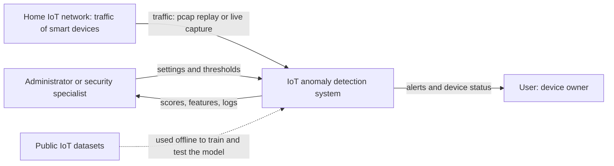
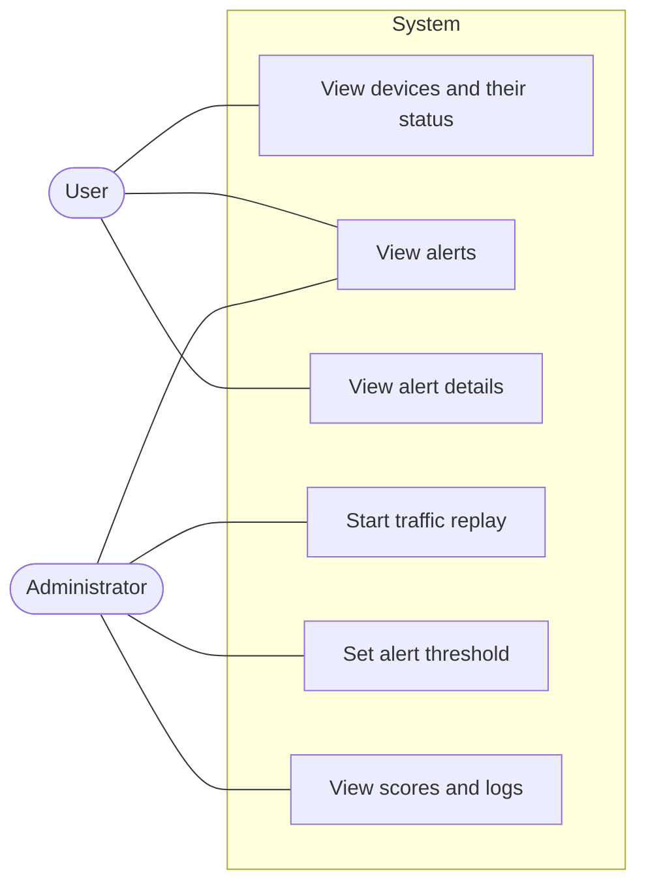
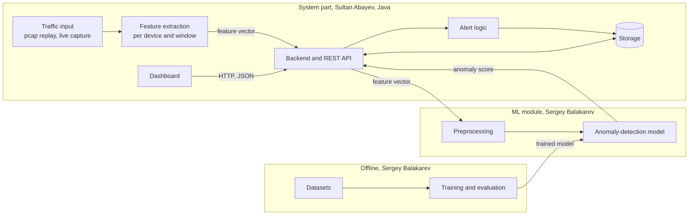
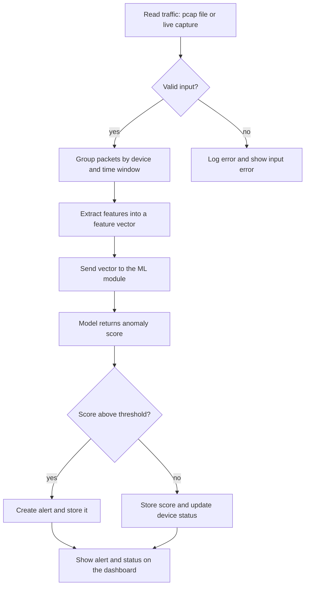
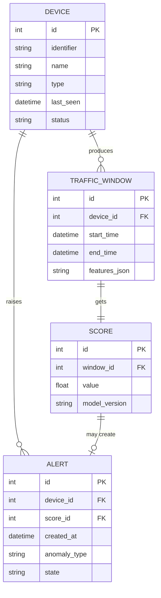

# Intelligent System for Anomaly Detection in Home IoT Networks Based on Machine Learning Methods

Diploma project, Astana IT University, Software Engineering, group SE-2404.

Team:
 1) Abayev Sultan Aidarovich.
 2) Balakarev Sergey Sergeevich.

Supervisor: Turarova Marzhan Kabdikalievna.

A Java-based system that analyses the network traffic of smart-home devices, learns what
their normal behaviour looks like and notifies the user about suspicious activity: a
compromised device, network scanning, participation in a botnet or unusual data
transmission.

**Status:** Accepted. Work is in progress.

**Links**

- Repository: <https://github.com/Tofucherry/iot-anomaly-detection>
- Project board (GitHub Projects): <https://github.com/users/Tofucherry/projects/1/views/1?layout_template=board>

> **How to read this file.** `[ASSUMPTION]` marks a number or decision that is our own
> estimate and will be fixed after measurement or after the supervisor meeting.

## Contents

1. [Project proposal](#1-project-proposal)
2. [Relevance of the problem](#2-relevance-of-the-problem)
3. [Literature review](#3-literature-review)
4. [Existing systems](#4-existing-systems)
5. [Technology comparison](#5-technology-comparison)
6. [Requirements](#6-requirements)
7. [Architecture and diagrams](#7-architecture-and-diagrams)
8. [UX and prototype](#8-ux-and-prototype)
9. [Verification plan](#9-verification-plan)
10. [Project management](#10-project-management)
11. [Supervisor feedback](#11-supervisor-feedback)

## Repository

GitHub: <https://github.com/Tofucherry/iot-anomaly-detection>

```
README.md        this file: all components
backend/         Java service: traffic input, feature extraction, API, storage
ml/              anomaly-detection module, training and evaluation
dashboard/       web dashboard: devices, alerts, status
data/            dataset download and preparation scripts (raw datasets are not committed)
docs/diagrams/   diagram sources and exported images
docs/design/     exported mockups
tests/           automated tests
.gitignore
```

The folder names are a proposal and follow the split of work in 1.2.

### Working rules

- One repository. Each member commits from their own account.
- Every task has a YouTrack ID. It appears in the branch name, for example
  `feature/DIP-12-short-name`, in each commit message, for example `[DIP-12] short message`,
  and in the pull request title. YouTrack project key: `DIP`.
- Every change goes in through a pull request that the other member reviews.
- Submitted versions are tagged throughout the development, e.g. `pre-defense-1`,
  `defense-version-1` and so on.

### License

MIT License. (Confirmed after verifying that the chosen ML library Smile uses the MIT License and that public research datasets IoT-23 and N-BaIoT allow academic use).

---

## 1. Project Proposal

### 1.1 Title

Development of an Intelligent System for Anomaly Detection in Home IoT Networks Based on
Machine Learning Methods

### 1.2 Team and supervisor

| Role | Name | Responsibility |
|------|------|----------------|
| Team member | Sultan Abayev | System part in Java: architecture; traffic collection and feature extraction; backend and API; data storage; integration of the ML module; dashboard prototype; analysis of existing systems; technology comparison for system components; system requirements; system and integration tests |
| Team member | Sergey Balakarev | Machine-learning part: review of IoT attacks and public datasets; literature review on ML-based detection; features, preprocessing and models; comparison of ML libraries and algorithms; ML requirements; evaluation plan with metrics and baseline |
| Supervisor | Marzhan Turarova | Reviews key deliverables and pull requests |

First names are used in the rest of this document.

Shared: proposal, relevance evidence, requirements, architecture diagrams, risk list, and
the interface between the system part and the ML module (the feature format and the model
input and output). Each member reviews the other's pull requests.

### 1.3 Problem

Smart-home devices such as cameras, plugs, speakers and hubs are connected to the home
network all the time, but their owners are usually not security specialists. The devices
have limited resources, so protection software often cannot run on them, and a compromised
device can scan the local network, join a botnet or send data out without the owner
noticing (supported by Mirai, N-BaIoT, and IoT-23 literature in section 3).

Existing tools either need expert configuration and rules (section 4) or are closed
consumer products whose detection method we cannot inspect. The project builds a system that
learns the normal traffic of each device and reports deviations from it, and measures how
well it does that on public IoT datasets and in simulated attacks.

The relevance of the problem is checked with 3 to 5 conversations, section 2. Until they are
done, the problem statement above is an assumption.

### 1.4 Users

- Owners of smart-home devices who want to know if a device behaves strangely.
- Network administrators and IT security specialists as secondary users, who may want the
  scores and the traffic features and not only the alerts (confirmed in section 2 by participant P2).

### 1.5 Aim

To develop a Java-based system that collects the network traffic of home IoT devices,
extracts features from it, detects anomalous behaviour with machine-learning methods and
shows alerts and device status to the user. The system is evaluated on public datasets and
with simulated attacks.

### 1.6 Objectives

| # | Objective | Result at the end of the objective | Owner |
|---|-----------|------------------------------------|-------|
| 1 | Review the literature and existing systems | Literature review, comparison of 3 to 5 existing systems | Sergey: ML-based detection; Sultan: IoT security, network monitoring, existing systems |
| 2 | Check the need with real users | Notes from 3 to 5 conversations, findings separated from assumptions | Both |
| 3 | Define requirements | Functional and non-functional requirements with acceptance criteria | Both, each for their component |
| 4 | Design the system | Context, use case and component diagrams, data flow, API contract | Sultan: system components; Sergey: ML module |
| 5 | Build the system part | Traffic input, feature extraction, backend, API, storage | Sultan |
| 6 | Build the ML part | Prepared datasets, trained candidate models and a baseline detector | Sergey |
| 7 | Integrate | One flow from traffic to alert on the dashboard, with the model running in near real time | Both |
| 8 | Evaluate | Metrics on a held-out set, comparison with the baseline, cross-dataset check, tests with simulated attacks, latency and resource use | Sergey: model; Sultan: system tests |

For the first pre-defense on 24 October 2026 the deliverables are objectives 1 to 4, the
prototype materials, the verification plan and the project plan. A complete application is
not expected at this stage. Objectives 5 to 8 are planned in section 10.

### 1.7 Scope

**In scope, first version** [ASSUMPTION: all items are proposals and are confirmed with the
supervisor, see section 10.3]
- Traffic from a smart-home network, taken from recorded files (pcap replay) as the main
  input. Live capture from a real or emulated network is optional.
- Detection of a short, fixed list of anomaly types: network scanning, participation in a
  botnet and abnormal data transmission.
- A fixed list of device types, chosen from what the datasets cover, such as cameras, smart
  plugs and speakers.
- Learning of normal behaviour from benign traffic, and an anomaly score for each window of
  traffic.
- A backend with an API, a database, and a dashboard with the list of devices, their status
  and the alerts.

**Out of scope**
- Blocking traffic or acting as a firewall. The system only detects and notifies.
- Reading the content of encrypted traffic. Only traffic metadata and statistics are used.
- Scanning devices for vulnerabilities and analysing device firmware.
- Several homes, user accounts for many households, payments.
- A mobile app.

### 1.8 Approach and planned technology

All choices below are provisional until section 5 is confirmed with the supervisor.

| Part | Choice | Owner |
|------|--------|-------|
| Traffic input | Replay of recorded pcap files, with live capture as an option. Alternatives compared in section 5.3 | Sultan |
| Feature extraction | Own Java module that builds features per device and per time window | Sultan |
| Anomaly detection | Candidates: Isolation Forest, One-Class SVM, autoencoder, compared in section 5.1, against a simple statistical baseline | Sergey |
| ML library | A Java library, or a model trained outside Java and run from Java. Alternatives compared in section 5.2 | Sergey |
| Backend and storage | Java backend framework with a relational database. Alternatives compared in section 5.4 | Sultan |
| Dashboard | Web dashboard. Alternatives compared in section 5.5 | Sultan |
| Design and prototype | Mockups of the key scenarios, section 8 | Sultan, team review |

### 1.9 Why this is an engineering project and not only a model

The project combines network traffic processing, feature extraction, a model trained on
public datasets that must still work on other traffic, a backend that connects the parts,
and an evaluation that includes false alarms and detection delay. It also includes choosing
between alternatives and handling errors such as broken capture files or unknown devices.

### 1.10 Expected outcomes

- A documented design and requirements, traceable in YouTrack and in the repository.
- A working prototype that detects the chosen anomaly types, with measured quality.
- A comparison with a baseline detector and a cross-dataset check.
- A report on what works, what does not and what was left out.

### 1.11 Preliminary success criteria

[ASSUMPTION: these are placeholders and are set in the verification plan after a baseline
is measured.]

- Better F1 and ROC-AUC than the baseline detector on the same test split.
- A false-positive rate below a limit that we fix after the baseline is measured.
- Detection latency of a few seconds in the replay test.
- Detection of the anomaly types from 1.7 in simulated attacks in an isolated lab network.

### 1.12 Risks

Likelihood L and impact I are rated Low, Medium or High. [ASSUMPTION: all ratings are our
own estimates and not measured. We review them every week.] Each risk is also a label in
YouTrack.

| ID | Risk | L | I | Owner | Mitigation | Warning sign and fallback |
|----|------|---|---|-------|------------|---------------------------|
| R1 | Public datasets differ from real home traffic, so the model works on them but not elsewhere | H | H | Sergey | Cross-dataset checks; simulated attacks in our own lab; state the limits openly | Quality drops sharply on a second dataset: reduce the claims and add lab traffic |
| R2 | Too many false alarms make the system useless for a home user | H | H | Sergey | Measure false-positive rate from the start; tune the threshold on validation data only; compare with the baseline | False-positive rate is above the limit: raise the threshold or narrow the anomaly types |
| R3 | The test set leaks into training, for example the same capture in both | M | H | Sergey | Split by device or capture, never randomly; never tune on the test set | Suspiciously high scores: check the split for overlap |
| R4 | The datasets are imbalanced or have unreliable labels | M | M | Sergey | Audit each dataset per class; report class counts | A class has very few samples: drop it from the anomaly list |
| R5 | The Java ML libraries lack the chosen algorithm or are too slow | M | M | Sergey | Check the algorithms and speed of each library early; keep the alternative in 5.2 | The chosen algorithm is missing: use another algorithm, or train outside Java and run the model from Java |
| R6 | Feature formats of the system part and the ML part do not match | M | H | Both | Agree the feature vector and the model interface early, section 8.3; test them together before the integration stage | A format change is needed late: freeze the format and adapt the preprocessing |
| R7 | Live capture needs permissions and raises privacy questions | M | M | Sultan | Use recorded files first; keep captured traffic out of the repository; capture only our own test network | Capture does not work: stay with replay |
| R8 | Encrypted traffic leaves only metadata, which may limit the detectable anomalies | M | M | Both | Choose anomaly types that show in metadata, such as scanning, volume and destinations | An anomaly type cannot be detected from metadata: drop it from 1.7 |
| R9 | Near-real-time processing is too slow | M | M | Sultan | Measure latency and resources in the evaluation; process in windows | Latency is above the target: use larger windows or a lighter model |
| R10 | Licences of datasets or libraries restrict how the project can be published | L | M | Both | Check each licence before use; record it in the repository | A licence forbids the use: replace the dataset or library |
| R11 | Attack simulations could harm real devices or networks | L | H | Sultan | Run simulations only in an isolated lab network that we own | A simulation reaches a network outside the lab: stop and review |
| R12 | The conversations do not confirm the problem, or we cannot find enough people | M | H | Both | Keep findings and assumptions separate, section 2; ask the supervisor for contacts | Not enough support: tell the supervisor and keep the claim in 1.3 weak |
| R13 | One member is unavailable or the workload is uneven | M | M | Both | Documented split of work; each member reviews the other's pull requests; weekly check in YouTrack | A task is late for a week: move it or reduce the scope |
| R14 | Scope grows, for example more anomaly types, blocking or a mobile app | M | M | Both | Keep to 1.7; write new ideas under future work, not into the plan | A task is not in 1.7: do not start it |
| R15 | Not enough time before 24 October | H | M | Both | Pre-defense 1 is documents, diagrams and prototype materials; development is planned for the next stages | A component is not started by 21 October: tell the supervisor |

### 1.13 Plan for pre-defense 1

The documents, diagrams, prototype materials, verification plan and project plan are
prepared for 24 October 2026 and this README is submitted with the tag `pre-defense-1`.
Status of items:
- Project proposal: Done
- Literature review: Drafted
- Existing systems: Done
- Technology comparison: Done
- Requirements: Done
- Architecture diagrams: Done
- Prototype materials: Done
- Verification plan: Done
- Project plan: Done

---

## 2. Relevance of the Problem

### 2.1 Purpose

Section 1.3 says that owners of smart-home devices usually cannot tell whether a device
behaves strangely. This section records 3 to 5 conversations and shows which claims they
support. With so few participants the findings are indications and not proof. Verified
findings are kept separate from assumptions.

### 2.2 Method

We conducted three semi-structured interviews with potential users to verify the problem statement and gather initial requirements.

- Participants: owners of smart-home devices and network administrators.
- Format and date of each conversation: recorded video calls and in-person meetings between 15 and 16 October 2026.
- Participants are anonymous, P1 to P3.
- Negative and critical answers are recorded the same way as positive ones.

### 2.3 Interview guide

1. Which smart-home devices do you have, and how many of them are connected to the network?
2. How do you know what your devices are doing on the network?
3. Has a device ever behaved strangely, for example slow, offline or sending a lot of data? What happened?
4. Have you ever worried that a device might be hacked? When?
5. What do you do today to protect the home network? Which tools do you use?
6. What do you find hard or annoying about those tools?
7. Would you want to be notified about suspicious device behaviour? How, and how often?
8. What would be an acceptable number of false alarms?
9. Would you trust a system that learns normal behaviour by itself? What would make you not trust it?
10. What would you want to see first on the screen when an alert comes?
11. Would you share your network traffic with such a system? Under what conditions?
12. Is there anything about this problem that I haven't asked and you think matters?

### 2.4 Interview log

| ID | Date | Participant type | Format |
|----|------|------------------|--------|
| P1 | 15 Oct | Smart-home owner (5 devices) | Video call |
| P2 | 16 Oct | Network administrator | In person |
| P3 | 16 Oct | Smart-home owner (12 devices) | Chat |

### 2.5 Findings

| Claim from the proposal | What participants said | Result |
|-------------------------|------------------------|--------|
| C1. Owners cannot easily tell when a smart device behaves suspiciously | "I have no idea what my camera is sending or where" (P1, P3) | Supported |
| C2. Current tools need expertise or are closed products | "Tried Wireshark but it's too complex for home" (P1). "Most people use nothing" (P2) | Supported |
| C3. Owners would want to be notified about anomalies | "Only if it's not every 5 minutes" (P3). "Immediate alert for new devices" (P2) | Supported |
| C4. Owners would trust a system that learns normal behaviour | "If it explains why it thinks so" (P1, P2) | Supported |

### 2.6 What changes in the project

- Alert screen must show the reason or the feature that triggered it (F4).
- Add "Ignore device" feature for known high-traffic devices (F3).

### 2.7 Limits of these interviews

We interviewed 3 participants. While they represent both target user groups (home owners and experts), the sample size is small and not representative of all IoT users. The findings serve as initial indications for the design.

---

## 3. Literature Review

Requirement from the plan: at least 12 sources that are really used, at least 8 of them
scientific publications, covering IoT attack types, IoT traffic datasets and ML-based
anomaly detection, with recent sources first for fast-moving topics.

### 3.1 Analysis table

| ID | Source | What they did | Result | Limitation they report | Why it matters here |
|----|--------|---------------|--------|------------------------|---------------------|
| S1 | Antonakakis et al., 2017, USENIX Security, "Understanding the Mirai Botnet" | Seven-month measurement study of how the Mirai botnet emerged, grew and attacked | Growth to a peak of about 600k infections; the original variant infected devices through Telnet and SSH logins with default credentials | One botnet family and its variants, measured from the Internet side and not inside a home network | Shows how compromised IoT devices are abused, which defines our anomaly types |
| S2 | Meidan et al., 2018, IEEE Pervasive Computing, "N-BaIoT" | Detected botnet traffic from IoT devices with deep autoencoders | High accuracy on 9 devices; released a dataset | Needs per-device training and benign data | Per-device normal behaviour and an autoencoder, close to our approach; also a dataset |
| S3 | Mirsky et al., 2018, NDSS, "Kitsune" | Online network intrusion detection with an ensemble of autoencoders | Near-real-time detection on a Raspberry Pi | Complex architecture | Near-real-time detection with little labelled data |
| S4 | Parmisano, Garcia, Erquiaga, 2020, IoT-23 dataset (Stratosphere Laboratory) | Published labelled benign and malicious IoT traffic captures | 23 large captures from real IoT devices | Imbalanced classes | Candidate dataset |
| S5 | Neto et al., 2023, Sensors, "CICIoT2023" | Built a dataset of many attack types against IoT devices | Includes 33 attack types and benign traffic | Large file sizes | Candidate dataset, many attack types |
| S6 | Liu, Ting, Zhou, 2008, ICDM, "Isolation Forest" | Proposed an algorithm that isolates anomalies instead of profiling normal points | High efficiency and low memory use for large datasets | Assumes anomalies are rare and significantly different | Candidate algorithm for the first version |
| S7 | Scholkopf et al., 2001, Neural Computation, one-class SVM | Developed an algorithm to estimate the support of a distribution | Effective for high-dimensional data without a density model | Sensitive to kernel choice and feature scaling | Candidate algorithm for comparison |
| S8 | Chandola, Banerjee, Kumar, 2009, ACM Computing Surveys, "Anomaly detection: a survey" | Provided a comprehensive taxonomy of anomaly detection methods | Established terminology and comparison criteria | General survey, not specific to IoT constraints | Background and terminology for the project |
| S9 | Kikissagbe and Adda, 2024, Electronics, "Machine Learning-Based Intrusion Detection Methods in IoT Systems: A Comprehensive Review" | Reviewed supervised, unsupervised, deep-learning and hybrid ML methods for intrusion detection in IoT, covering articles from 2013 to 2024 | Overview of the approaches and the challenges of applying them to IoT | Review only, no own experiments | Up-to-date context on ML methods for IoT intrusion detection |
| S10 | Rafique et al., 2024, Sensors, "Machine Learning and Deep Learning Techniques for Internet of Things Network Anomaly Detection: Current Research Trends" | Reviewed 60 papers from 2018 to 2024 on ML and DL anomaly detection in IoT networks | Concludes that further development needs varied datasets, real-time testing and scalable systems | Review only, no own experiments | Supports cross-dataset evaluation (R1) and near-real-time testing |
| S11 | Alsoufi et al., 2021, Applied Sciences, "Anomaly-Based Intrusion Detection Systems in IoT Using Deep Learning: A Systematic Literature Review" | Systematic literature review of anomaly-based IoT intrusion detection with deep learning | Found that supervised deep-learning techniques performed better than unsupervised and semi-supervised ones | Focus on deep learning; results come from the reviewed studies | Reason to add a supervised reference model next to our unsupervised detectors |
| S12 | Smile Documentation, 2024, haifengl.github.io | Official documentation for the Statistical Machine Intelligence and Learning Engine | Details on implementation and API for Isolation Forest and SVM | Limited academic discussion of algorithm variants | Documentation for the chosen ML library |

### 3.2 What the literature shows

- **IoT Attack Vectors:** Botnets like Mirai (S1) remain a primary threat, utilizing compromised devices for scanning and DDoS. Attacks manifest as abnormal packet volumes and unique destination patterns.
- **Dataset Diversity:** Public datasets like IoT-23 (S4) and CICIoT2023 (S5) provide essential ground truth but differ in attack types and device diversity, making model generalization a challenge (S10).
- **Algorithm Performance:** Unsupervised methods like Isolation Forest (S6) and One-Class SVM (S7) can be trained on benign traffic only, which suits a home network without labelled attacks; reviewed studies report better performance for supervised deep learning when labelled attack data exist (S11). Near-real-time detection is feasible even on resource-constrained devices (S3).
- **Quality Metrics:** While high accuracy is reported (S2), it is often tied to a single dataset. Evaluation must include F1-score and false-positive rates to be meaningful in home environments.

### 3.3 Research gap

Many academic studies report high performance on a single, static dataset. However, home IoT environments are dynamic, and models often fail to generalize to new devices or network conditions. Furthermore, there is a lack of integrated, open-source systems that combine feature extraction, ML-based detection, and a user-friendly dashboard for non-experts.

| Limitation in the literature | What the project does about it |
|------------------------------|--------------------------------|
| Models trained and tested on the same dataset distribution | Cross-dataset evaluation on IoT-23 and N-BaIoT (R1) |
| High complexity of implementation for home users | Integrated dashboard using Thymeleaf and HTMX (FR7) |
| Focus on specific model architectures over end-to-end systems | Full implementation from pcap input to dashboard alerts |

### 3.4 Limits of this review

- It is not a systematic review. We chose the sources ourselves, so it could miss work that uses different terminology.
- Most quality figures in the literature come from the authors' private test sets, making direct comparison difficult.
- The review focuses on network-layer features, potentially overlooking application-layer vulnerabilities.

### 3.5 References

S1. Antonakakis, M., et al. (2017). "Understanding the Mirai Botnet." In 26th USENIX Security Symposium (USENIX Security 17), pp. 1093-1110. https://www.usenix.org/conference/usenixsecurity17/technical-sessions/presentation/antonakakis

S2. Meidan, Y., Bohadana, M., Mathov, Y., Mirsky, Y., Shabtai, A., Breitenbacher, D., & Elovici, Y. (2018). "N-BaIoT: Network-Based Detection of IoT Botnet Attacks Using Deep Autoencoders." IEEE Pervasive Computing, 17(3), 12-22. DOI: 10.1109/MPRV.2018.03367731.

S3. Mirsky, Y., et al. (2018). "Kitsune: An Ensemble of Autoencoders for Online Network Intrusion Detection." NDSS. DOI: 10.14722/ndss.2018.23204.

S4. Parmisano, A., Garcia, S., & Erquiaga, M. J. (2020). "A labeled dataset with malicious and benign IoT network traffic (IoT-23)." Stratosphere Laboratory, Czech Technical University in Prague. DOI: 10.5281/zenodo.4743746. https://www.stratosphereips.org/datasets-iot23

S5. Neto, E. C. P., Dadkhah, S., Ferreira, R., Zohourian, A., Lu, R., & Ghorbani, A. A. (2023). "CICIoT2023: A Real-Time Dataset and Benchmark for Large-Scale Attacks in IoT Environment." Sensors, 23(13), 5941. DOI: 10.3390/s23135941.

S6. Liu, F. T., Ting, K. M., & Zhou, Z. H. (2008). "Isolation Forest." ICDM. DOI: 10.1109/ICDM.2008.17.

S7. Scholkopf, B., Platt, J. C., Shawe-Taylor, J., Smola, A. J., & Williamson, R. C. (2001). "Estimating the Support of a High-Dimensional Distribution." Neural Computation, 13(7), 1443-1471. DOI: 10.1162/089976601750264965.

S8. Chandola, V., Banerjee, A., & Kumar, V. (2009). "Anomaly Detection: A Survey." ACM Computing Surveys. DOI: 10.1145/1541880.1541882.

S9. Kikissagbe, B. R., & Adda, M. (2024). "Machine Learning-Based Intrusion Detection Methods in IoT Systems: A Comprehensive Review." Electronics, 13(18), 3601. DOI: 10.3390/electronics13183601.

S10. Rafique, S. H., Abdallah, A., Musa, N. S., & Murugan, T. (2024). "Machine Learning and Deep Learning Techniques for Internet of Things Network Anomaly Detection: Current Research Trends." Sensors, 24(6), 1968. DOI: 10.3390/s24061968.

S11. Alsoufi, M. A., et al. (2021). "Anomaly-Based Intrusion Detection Systems in IoT Using Deep Learning: A Systematic Literature Review." Applied Sciences, 11(18), 8383. DOI: 10.3390/app11188383.

S12. Smile Documentation. (2024). Statistical Machine Intelligence and Learning Engine. https://haifengl.github.io/

---

## 4. Existing Systems

### 4.1 Which systems were compared and why

The comparison covers tools that detect suspicious activity in a home or small network. The
candidates from the plan are:

- **Rule-based network detection**, open source: Suricata or Snort, and Zeek (network
  analysis logs and scripting).
- **Consumer products for home networks**: Firewalla, Bitdefender BOX, Fingbox.

Tools for other purposes, such as antivirus for computers or enterprise SIEM platforms,
were left out because they are not aimed at home IoT networks.

> The cells below are written from general knowledge and **must be checked by the team**
> against each product's current documentation before submission. Some products may have
> changed or been discontinued. `Not noted` means that nothing was recorded for that point.

### 4.2 Criteria

1. Aimed at home or small networks, with setup that a non-expert can manage.
2. Detects anomalies by learning normal behaviour, not only by fixed rules or signatures.
3. Works per device, with a device list and device status.
4. Detects network scanning.
5. Detects botnet activity or communication with malicious hosts.
6. Detects unusual data transmission.
7. Alerts and a dashboard that a non-expert can read.
8. Open source or inspectable, so the method and the data are visible.
9. Can be extended or integrated with our own detection module.
10. Free or low cost.

### 4.3 Comparison

| System | Type | 1. Home use, easy setup | 2. Learns normal behaviour | 3. Per-device view | 4. Scanning | 5. Botnet | 6. Unusual data | 7. Alerts and dashboard | 8. Inspectable | 9. Extensible | 10. Cost |
|--------|------|------|------|------|------|------|------|------|------|------|------|
| Suricata / Snort | Rule-based IDS | No (expert) | No (rules) | Yes | Yes | Yes | Yes | No (complex) | Yes | Yes | Free |
| Zeek | Network analysis | No (expert) | Scriptable | Yes | Yes | Yes | Yes | No (logs) | Yes | Yes | Free |
| Firewalla | Consumer product | Yes | Yes (simple) | Yes | Yes | Yes | Yes | Yes | No | No | Paid |
| Bitdefender BOX | Consumer product | Yes | Some | Yes | Yes | Yes | Yes | Yes | No | No | Paid |
| Fingbox | Consumer product | Yes | Some | Yes | Yes | No | No | Yes | No | No | Paid |

### 4.4 What the comparison shows

The comparison shows that open-source tools like Suricata and Zeek are powerful and extensible but too complex for a typical home user. Consumer products like Firewalla and Fingbox provide a good user experience but are closed systems that cannot be easily inspected or extended with custom ML models. Our project aims to fill this gap by providing an open, ML-based system with a user-friendly dashboard.

---

## 5. Technology Comparison

This section justifies the stack in 1.8. Each decision compares the chosen technology with
two or three alternatives. Anything about quality or speed on our own data is marked
ASSUMPTION until we measure it, and the results go into the verification plan.

### 5.1 Anomaly-detection algorithm

Criteria: works without labelled attacks or with few; works on tabular traffic features;
speed of training and prediction; whether it is available in a Java library; how easy it is
to explain a score.

| Option | Strengths | Weaknesses |
|--------|-----------|------------|
| **Isolation Forest**, proposed | Unsupervised, fast, few parameters, gives an anomaly score | Threshold must be tuned; quality on our features unknown |
| One-Class SVM | Learns the boundary of normal data; well known | Sensitive to parameters and scaling; slower on large data |
| Autoencoder | Used for IoT traffic in the literature (S2, S3); can model complex normal behaviour | More data and tuning; heavier to run from Java |
| Statistical threshold, **baseline** | Very simple and transparent | Cannot capture combinations of features |

**Decision:** [ASSUMPTION: start with Isolation Forest and compare with the other two
algorithms and with the statistical baseline on the same split. The choice stays
provisional until the comparison is measured.]

### 5.2 ML library for Java

Criteria: the algorithms from 5.1 are available; maintained; licence; speed; effort to
integrate into the Java backend.

| Option | Strengths | Weaknesses |
|--------|-----------|------------|
| **Smile**, decision | Java library with many algorithms including Isolation Forest and SVM | Needs careful integration with Spring Boot |
| Weka | Well known, many algorithms, a GUI for experiments | GPL license; moderate speed; needs wrapper for API |
| Model trained outside Java, run from Java through ONNX Runtime or DJL | Free choice of training tools; autoencoders are easier | Two tool chains; the export has to be checked |
| Tribuo or Deeplearning4j | Modern, enterprise-grade | Steeper learning curve for simple models |

**Decision:** Smile is chosen for its simplicity, speed, and availability of the required algorithms (Isolation Forest and SVM) under the MIT license.

### 5.3 Traffic input

Criteria: works without special hardware; repeatable for tests; close to real use; effort.

| Option | Strengths | Weaknesses |
|--------|-----------|------------|
| **Replay of recorded pcap files**, proposed | Repeatable; public datasets come as pcap or as extracted tables; easy to test | Not live; depends on what the datasets contain |
| Live capture on a real or emulated network, for example with the Java library pcap4j | Shows real operation | Needs permissions and a test network; harder to repeat; privacy (R7) |
| Ready feature tables from the datasets | Fastest start | Our feature extraction would not be tested end to end |

**Decision:** [ASSUMPTION: pcap replay as the main input, live capture as an optional
extension, and ready feature tables only for early model experiments. To be confirmed with
the supervisor.]

### 5.4 Backend framework and storage

Criteria: Java; effort to learn and run; REST API support; storage of device records,
alerts and scores; setup.

| Option | Strengths | Weaknesses |
|--------|-----------|------------|
| **Spring Boot with Spring Data JPA**, proposed | Widely used Java framework; REST API and database access built in; the team knows it | Heavier than minimal frameworks |
| Quarkus or Micronaut | Fast start, small footprint | Less familiarity within the team; smaller ecosystem for some ML integrations |
| Javalin or plain Java HTTP | Very light | More code to write for validation and storage |

| Storage option | Strengths | Weaknesses |
|----------------|-----------|------------|
| **PostgreSQL**, proposed | Relational data fits devices, alerts and scores; supports time-based queries | A server to run |
| SQLite | A single file, no server | One writer at a time |
| Time-series database | Made for measurements over time | Another technology to learn; the data volume may not need it |

**Decision:** [ASSUMPTION: Spring Boot with PostgreSQL. To be confirmed with the
supervisor, together with any mandatory constraints on language, libraries and storage.]

### 5.5 Dashboard

Criteria: ease of development; responsiveness; integration with Spring Boot.

| Option | Strengths | Weaknesses |
|--------|-----------|------------|
| **Thymeleaf with HTMX**, decision | Simple, server-side rendering, same project as backend | Less dynamic than a full SPA |
| React or Vue.js | Modern, highly dynamic, separate front-end | More work; separate build and deployment |
| JavaFX | Desktop UI, easy to access backend directly | Not accessible via web browser |

**Decision:** Thymeleaf with HTMX for the first prototype to keep the development fast and integrated within the Spring Boot project.

### 5.6 Resulting stack

| Part | Choice |
|------|--------|
| Language | Java |
| Traffic input | [ASSUMPTION] pcap replay, live capture optional |
| Anomaly detection | [ASSUMPTION] Isolation Forest first, compared with two other algorithms and a baseline |
| ML library | Smile |
| Backend | Spring Boot |
| Storage | PostgreSQL |
| Dashboard | Thymeleaf |
| Tasks and code | YouTrack, Git |

### 5.7 Links

- [Spring Boot](https://spring.io/projects/spring-boot)
- [Smile ML](https://haifengl.github.io/)
- [PostgreSQL](https://www.postgresql.org/)
- [Thymeleaf](https://www.thymeleaf.org/)

---

## 6. Requirements

Each requirement becomes a task in YouTrack. Numbers marked ASSUMPTION are placeholders
until the verification plan fixes them. The Source column points to the section of this
file or to the finding that the requirement comes from.

### 6.1 System requirements, Sultan

| ID | Requirement | Priority | Acceptance criterion | Source |
|----|-------------|----------|----------------------|--------|
| FR1 | The system reads traffic from a recorded pcap file | Must | A valid file is processed and produces feature vectors; a broken file gives an error message and does not stop the system | 1.7 |
| FR2 | The system builds features per device and per time window | Must | For a test file the number of vectors and the feature values match a hand-checked example | 1.7 |
| FR3 | The system keeps a record of each device seen in the traffic | Must | A device that appears in a file is listed once with its identifier and last activity | 1.7 |
| FR4 | The system sends feature vectors to the ML module and receives an anomaly score | Must | The interface in 8.3 is used; a test vector returns a score | 1.5 |
| FR5 | The system creates an alert when a score is above the threshold | Must | A test vector with a high score creates one alert with device, time and score | 1.5 |
| FR6 | The system stores devices, scores and alerts | Must | After a restart the stored data are still available | 1.5 |
| FR7 | The dashboard shows the device list, device status and alerts | Must | After a replay, the dashboard shows each device and its alerts | 1.5 |
| FR8 | The dashboard shows the details of an alert: device, time, anomaly type if known, score | Should | An alert opens a detail view with these fields | 2.6 |
| FR9 | The system writes logs for errors and key events | Should | A simulated failure produces a log entry | 1.7 |
| FR10 | Live capture from a network interface | Could | Packets from a test network produce feature vectors [ASSUMPTION: only if time allows] | 5.3 |

### 6.2 Machine-learning requirements, Sergey

| ID | Requirement | Priority | Acceptance criterion | Source |
|----|-------------|----------|----------------------|--------|
| FR11 | The model is trained on benign traffic, or on a labelled dataset, prepared by a documented script | Must | A fresh checkout reproduces the training data from the script | 1.5 |
| FR12 | The model gives an anomaly score for a feature vector | Must | The score for a test vector is in the agreed range | FR4 |
| FR13 | The first version detects the anomaly types from 1.7 | Must | Each type is detected in the held-out set and in at least one simulated attack, and the rates are reported | 1.7 |
| FR14 | A baseline detector is implemented | Must | The baseline runs on the same split and its metrics are reported | 9.1 |
| FR15 | The threshold is chosen on validation data | Must | The test set is not used to choose it | R3 |
| FR16 | The model is evaluated on a second dataset | Should | Results on the second dataset are reported next to the first | R1 |

### 6.3 Non-functional requirements

| ID | Requirement | Priority | Acceptance criterion | Source |
|----|-------------|----------|----------------------|--------|
| NFR1 | Detection quality | Must | Precision, Recall, F1, ROC-AUC are reported and better than the baseline [ASSUMPTION: exact limits fixed after the baseline is measured] | 1.11 |
| NFR2 | False-positive rate | Must | Below a limit fixed after the baseline is measured [ASSUMPTION] | R2 |
| NFR3 | Detection latency | Should | From the end of a traffic window to the alert at most a few seconds in the replay test [ASSUMPTION: value] | R9 |
| NFR4 | Inference time | Should | One feature vector is scored within a time fixed after measurement [ASSUMPTION] | R9 |
| NFR5 | Resource use | Should | CPU and memory are measured in the replay test and reported | R9 |
| NFR6 | Privacy | Must | Captured traffic is not committed to the repository; the stored data contain only features and device identifiers | R7 |
| NFR7 | Reproducible setup | Must | A fresh machine follows the README steps and gets a working backend and database | 1.9 |
| NFR8 | Safe testing | Must | Attack simulations run only in the isolated lab network | R11 |

---

## 7. Architecture and Diagrams

Names of components, endpoints and tables are working names until the interface between
the system part and the ML module is agreed by Sultan Abayev and Sergey Balakarev.

### 7.1 Context diagram



### 7.2 Use case diagram



### 7.3 Component diagram



### 7.4 Main flow



The threshold is chosen on validation data. [ASSUMPTION: whether one alert covers several
consecutive anomalous windows is decided in the design of the alert logic.]

### 7.5 Data flow

| From | To | Data |
|------|----|------|
| Traffic input | Feature extraction | Packets or flow records with device, time and size |
| Feature extraction | Backend | Feature vector: device, window, feature values |
| Backend | ML module | Feature vector |
| ML module | Backend | Anomaly score, model version |
| Backend | Storage | Devices, scores, alerts, logs |
| Backend | Dashboard | Device list, device status, alerts |

### 7.6 Data model



`status` of a device is for example normal or suspicious. `anomaly_type` can be empty when
the model cannot say which type it is. Raw packets are not stored in the database.

---

## 8. UX and Prototype

### 8.1 Key scenarios

1. The administrator starts a replay of a traffic file, or connects a capture source.
2. The system builds features, scores them and updates the device list.
3. The user opens the dashboard and sees which devices are normal and which are suspicious.
4. The user opens an alert and sees the device, the time and the score.

### 8.2 Screens

Mockups are exported to `docs/design/`.

| Screen | Content |
|--------|---------|
| Device list | Name, type, last activity, status |
| Alerts | Time, device, score, state |
| Alert details | Device, time window, score, anomaly type if known |
| Settings | Traffic source, threshold |

### 8.3 Input and output examples

Working examples of the interface between the system part and the ML module. The fields are
placeholders until the feature set is agreed.

Feature vector in:

```json
{
  "deviceId": "aa:bb:cc:dd:ee:01",
  "windowStart": "2026-10-20T12:00:00Z",
  "windowEnd": "2026-10-20T12:00:10Z",
  "features": {
    "packetCount": 420,
    "byteCount": 183500,
    "uniqueDestinations": 3,
    "uniqueDestinationPorts": 2,
    "meanPacketSize": 436.9
  }
}
```

Anomaly score out:

```json
{
  "deviceId": "aa:bb:cc:dd:ee:01",
  "windowStart": "2026-10-20T12:00:00Z",
  "score": 0.82,
  "modelVersion": "iforest-0.1"
}
```

---

## 9. Verification Plan

### 9.1 Model evaluation, Sergey

- Data: public IoT datasets, for example IoT-23, N-BaIoT and CIC IoT 2023, chosen after
  comparing their size, labels, attack types and fit with the device types in 1.7. The
  licence of each dataset is checked before it is used. R4, R10.
- Split: into training, validation and test sets by device or by capture, not randomly.
  R3.
- Metrics: Precision, Recall, F1, ROC-AUC and false-positive rate.
- Baseline: a statistical threshold or a rule-based detector, run on the same split.
- Cross-dataset check: train on one dataset and test on another. R1.
- Threshold: chosen on validation data, never on the test set.
- Algorithm comparison: the algorithms from 5.1 on the same split.

### 9.2 System and integration tests, Sultan

- Unit and API tests: valid file, broken file, empty file, unknown device, missing ML
  module, stored data after a restart.
- Integration tests: traffic input, feature extraction, the model, storage and the dashboard
  together, with the feature format from 8.3.
- Tests with simulated attacks in an isolated lab network: for example a port scan against
  a test device, and a large transfer to an unusual destination. NFR8.
- Detection latency: time from the end of a window to the alert.
- Resource use: CPU and memory during a replay.
- Reproducibility: a fresh checkout is set up using only the README steps, NFR7.

### 9.3 Traceability

| Requirement | How it is checked | Who |
|-------------|-------------------|-----|
| FR1 to FR3 | Unit tests with test files | Sultan |
| FR4, FR5 | Integration test with a test vector | Sultan |
| FR6 | Restart test | Sultan |
| FR7, FR8 | Manual check against the mockups | Sultan |
| FR9 | Simulated failure and log check | Sultan |
| FR11 to FR15 | Model evaluation, 9.1 | Sergey |
| FR16 | Cross-dataset check, 9.1 | Sergey |
| NFR1, NFR2 | Model evaluation, 9.1 | Sergey |
| NFR3 to NFR5 | Latency and resource measurement, 9.2 | Sultan |
| NFR6 | Code review and repository check | Both |
| NFR7 | Fresh-checkout test | Sultan |
| NFR8 | Review of the lab setup | Sultan |

---

## 10. Project Management

### 10.1 Schedule to the first checkpoint

| Dates | Task | Result | Owner |
|-------|------|--------|-------|
| 13 Oct | Scope and team alignment | Problem, users, scope, responsibilities, milestones confirmed | Both |
| 13 Oct | Repository and YouTrack | One repository with access for all members and the supervisor; YouTrack project and tasks | Both |
| 13 to 14 Oct | Project proposal | Section 1 | Both |
| 14 to 16 Oct | Evidence of relevance | 3 to 5 conversations or an agreement with a client; section 2 | Both |
| 14 to 18 Oct | Literature review | Section 3 | Sergey: ML detection; Sultan: IoT security and monitoring |
| 15 to 17 Oct | Existing systems | Section 4 | Sultan; Sergey reviews |
| 16 to 18 Oct | Technology comparison | Section 5 | Sultan: system choices; Sergey: ML choices |
| 17 to 19 Oct | Requirements | Section 6 | Both, each for their component |
| 18 to 20 Oct | Architecture and diagrams | Section 7 with editable sources | Sultan: system; Sergey: ML module |
| 19 to 21 Oct | UX and prototype | Section 8 | Sultan, team review |
| 20 to 21 Oct | Verification plan | Section 9 | Sergey: model; Sultan: system tests |
| 21 to 22 Oct | Repository documentation | README, folders, links to YouTrack | Both |
| 22 Oct | Internal consistency review | Proposal, requirements, architecture, prototype and verification plan do not contradict each other | Both |
| 23 Oct | Supervisor review | Feedback recorded in section 11 | Both and supervisor |
| 23 to 24 Oct | Final revision | Clean version tagged `pre-defense-1` | Both |

### 10.2 Stages after 24 October

The stages are in order, but their dates are not fixed yet.

| Stage | Objective | Main activities | Milestone |
|-------|-----------|-----------------|-----------|
| 2. Core development | Build the main components | System: traffic input, feature extraction, backend, API, storage, basic dashboard. ML: prepare datasets, preprocessing, train and tune candidate models, implement the baseline | Runnable modules and trained candidate models |
| 3. Integration | One end-to-end flow | Connect input, features, model, backend, storage and alerts; solve interface and format issues; adapt the model for near-real-time use | End-to-end prototype for the key scenarios |
| 4. Testing and evaluation | Show that the requirements are met | Functional and integration tests, model evaluation, comparison with the baseline, cross-dataset check, simulated attacks, latency and resource measurement, bug fixing | Measured results against the acceptance criteria |
| 5. Finalisation | Prepare the defense | Stabilise the code; documentation; results and limitations; thesis, presentation and demo | Defense-ready package |

### 10.3 Questions for the supervisor

- Which anomaly types and which device types does the first version support?
- Is the best way to collect the 3 to 5 pieces of evidence of relevance the one in section 2?
- Is the split confirmed: system part for Sultan and ML part for Sergey?
- Is traffic captured live from a real or emulated network, or replayed from datasets, and
  is training on public datasets enough?
- What is the minimum prototype expected on 24 October?
- Are there mandatory constraints on the language, ML libraries, storage or deployment?
- How often do we meet, and what is the next milestone after 24 October?

### 10.4 Tracking

- Project board: GitHub Projects, <https://github.com/users/Tofucherry/projects/1/views/1?layout_template=board>.
- Tasks and deadlines are in YouTrack. Each task has an owner, an expected outcome,
  acceptance criteria and a deadline. Board columns: `To Do`, `In Progress`, `Review`, `Done`.
  Labels: `risk`, `bug`, `feature`, `documentation`.
- Branches, commits and pull requests follow the working rules at the top of this file.
- Work is committed progressively and not only before a checkpoint.
- Meetings with the supervisor: Once a week, on Fridays.
- Once a week we review the risk table in 1.12 and update it.
- Each member's contribution is shown by their commits, pull requests and closed tasks.

---

## 11. Supervisor Feedback

| Date | Deliverable | Comment | Decision | Status |
|------|-------------|---------|----------|--------|
| 24 Oct | README and project plan for pre-defense 1 | Accepted. Work is in progress. | Accepted | Work is in progress |
